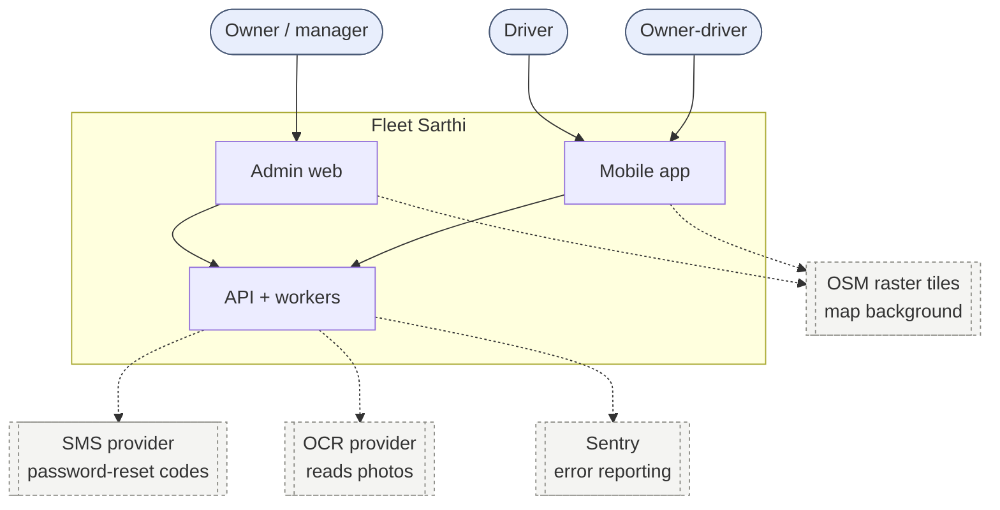
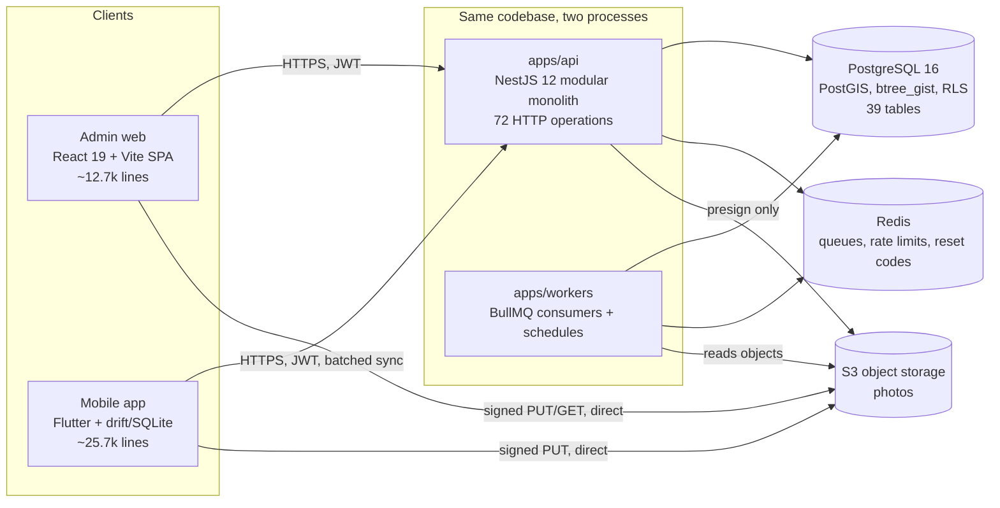
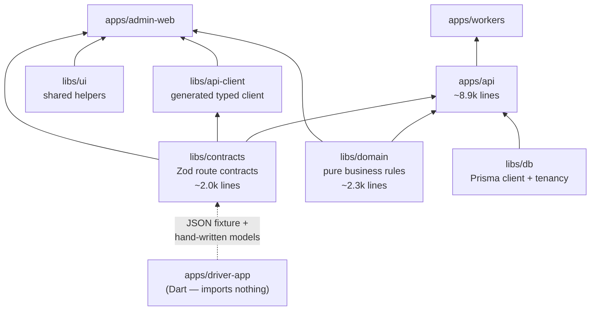
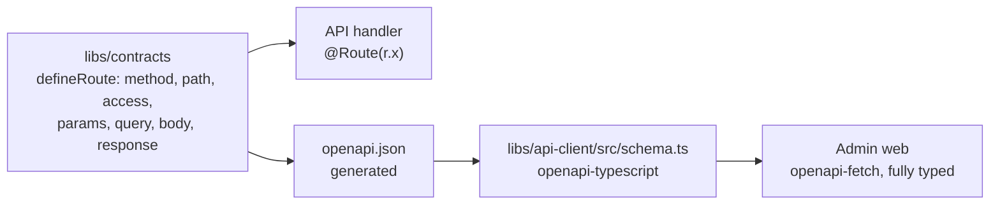
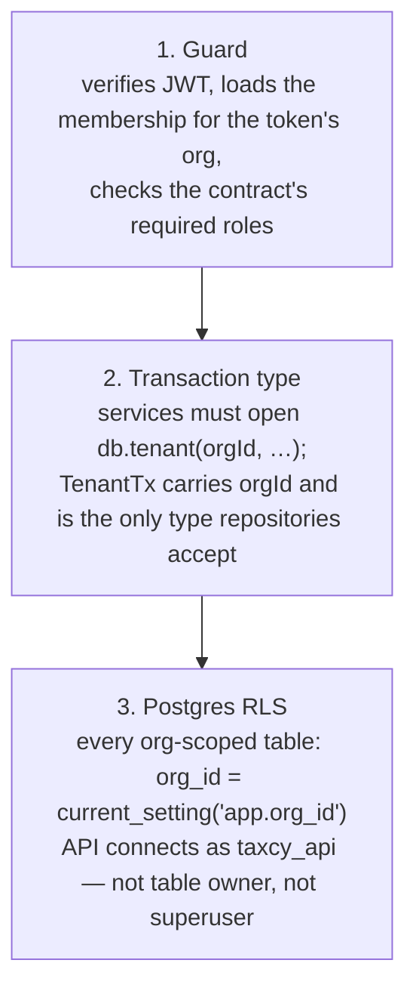
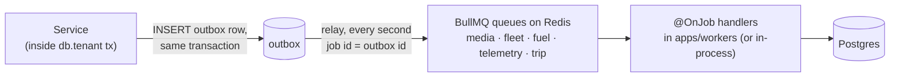
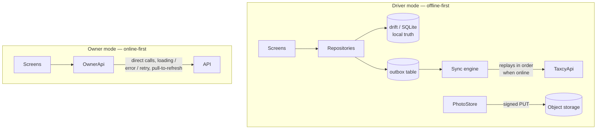
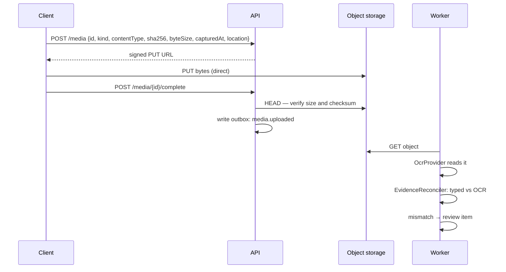
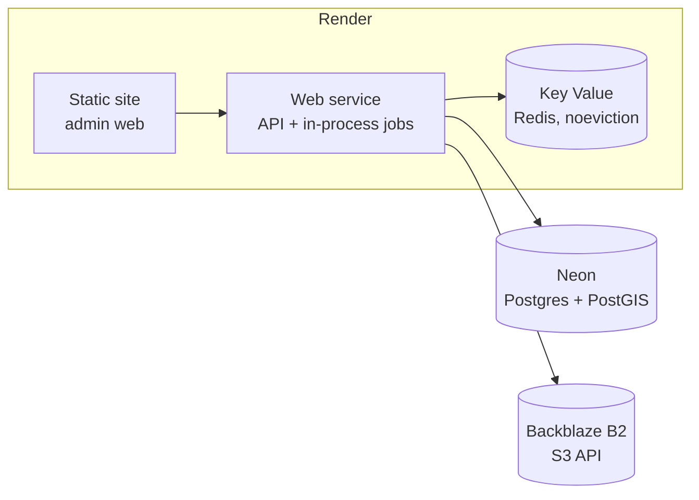

# High-level design

Fleet Sarthi is a fleet-management system for small Indian taxi operators: an owner or
manager runs the fleet from a web console, drivers record trips, odometer photos and
fuel fills from a phone that is often offline, and the server audits what comes back —
fuel efficiency against each vehicle's own history, odometer readings against GPS,
typed numbers against OCR — and settles each driver's day.

This page is the whole-system view: the pieces, why they are separate, and the rules
that hold across all of them. It is written to be read top to bottom once.

**Status.** Accurate as of 2026-10-12 (milestone M1.8, with the Analytics read model
from M1.9 included). Where the code and the older docs disagree, this page describes
the code and says so.

**How this relates to the other docs.** This one is the map; those are the territory.

| Read this for                                                | Page                                                                                                                                                                                                                 |
| ------------------------------------------------------------ | -------------------------------------------------------------------------------------------------------------------------------------------------------------------------------------------------------------------- |
| The backend's own summary: modules, layering, jobs, auth     | [architecture.md](architecture.md)                                                                                                                                                                                   |
| Schema conventions, Prisma's limits, the ER diagram          | [database.md](database.md)                                                                                                                                                                                           |
| Why things are the way they are, with consequences and risks | [decisions.md](decisions.md)                                                                                                                                                                                         |
| The rules inside one domain                                  | [domain/trips.md](domain/trips.md), [domain/fuel-audit.md](domain/fuel-audit.md), [domain/settlement.md](domain/settlement.md), [domain/telemetry.md](domain/telemetry.md), [domain/evidence.md](domain/evidence.md) |
| Running it locally, deploying it                             | [getting-started.md](getting-started.md), [development.md](development.md), [deployment.md](deployment.md)                                                                                                           |

---

## 1. System context



Three kinds of people, two front ends. Owners and managers ("staff") use the web
console; drivers use the phone app; an owner-driver is one person who is both, and the
app switches between an owner mode and a driver mode for them.

Every external dependency is optional or stubbed today. `SmsProvider` and `OcrProvider`
are interfaces chosen by environment variable, and both currently resolve to stubs
(`ConsoleSmsProvider` prints the reset code to the log, `StubOcrProvider` returns
configured values). There is no maps or payments provider yet: map pins are typed by
hand, and nothing takes payments. This matters for the design — the system has no hard
runtime dependency on a third party, so it runs end to end on a laptop.

---

## 2. Containers



Five runtime pieces. The two that matter most architecturally:

**`apps/api` and `apps/workers` are one codebase in two processes.** They import the
same `DOMAIN_MODULES` list and the same services; `apps/workers/src/main.ts` is 40
lines that build a Nest _application context_ with no HTTP server, start the job
runner, and expose a Bull Board dashboard. The split exists so slow work — OCR, a
whole-vehicle fuel recompute, a PostGIS distance calculation — never occupies a request
thread and can scale on its own. The job runner itself lives in the API package
(`platform/jobs/job-runner.ts`), which is what makes the split optional: with
`JOBS_MODE=in-process` the API runs the relay, the queue consumers and the schedules
itself, and `apps/workers` refuses to start. That is how the free-tier deployment works
(§17).

**Photos never pass through the API.** Clients ask the API for a signed URL and then
PUT the bytes straight to object storage; the API only records metadata and verifies
size and checksum on confirmation (§14). The API stays small and stateless, and a
phone on a weak link is not holding an API connection open while it uploads.

---

## 3. Repository and build topology

A Bun-workspace monorepo with Nx as the task runner. Four deployable apps, five
libraries.



Three things are worth noticing in that graph.

**`libs/domain` has no I/O.** It takes plain data and returns plain data: the trip state
machine, the fuel baseline and cycle evaluation, settlement computation, odometer-vs-GPS
comparison, IST date handling. That is what makes the business rules cheap to unit-test
(most of the 47 test files) and lets the admin web import the _same_ functions the
server runs, so a fare or a verdict is never computed two slightly different ways.

**The Flutter app imports nothing.** It cannot consume TypeScript, so it is the one
place where duplication is unavoidable. Two mechanisms keep it honest: hand-written Dart
models with parsing tests, and a Dart port of the trip state machine checked against
`libs/domain/fixtures/trip-transitions.json` — 2,112 cases exported from the TypeScript
implementation. If the server's lifecycle changes and the app's port does not, that
fixture test fails.

**Nx caches on content, and `build` depends on `^build`.** Libraries are built before
their consumers, and `typecheck`/`lint`/`test` all depend on upstream builds. One
consequence is operational rather than architectural: running an Nx build while
`bun run dev` is watching rewrites `dist/` underneath `node --watch` and can knock the
dev API into a restart loop. Restart the dev server if that happens.

---

## 4. The contract-first spine

This is the defining choice of the codebase, and most of the type safety downstream
follows from it.



A route is declared once, as data, with Zod schemas for each part:

```ts
monthly: defineRoute({
  method: 'GET',
  path: '/analytics/monthly',
  summary: 'Daily fuel, revenue, distance and per-trip averages for one IST month',
  tag: 'analytics',
  access: access.staff,
  query: z.object({ year: z.coerce.number().int(), month: z.coerce.number().int().min(1).max(12) }),
  response: MonthlyAnalytics,
});
```

Everything else is derived from that declaration:

- **Binding.** `@Route(contract)` sets the HTTP method, the Express path, the success
  status and the contract as handler metadata. At startup `assertRoutesBound` checks
  every one of the 72 contracts has exactly one handler — a declared route with no
  implementation, or two handlers fighting over one path, fails the boot rather than
  shipping.
- **Input.** `@Input()` parses `params`, `query` and `body` through the contract's
  schemas, so a handler's arguments are already valid and typed. Rejections become a
  structured `VALIDATION_FAILED` listing each bad field.
- **Output.** `ContractResponseInterceptor` encodes every response _through the response
  schema_. Codecs turn `Date` into ISO strings, unknown fields are stripped so nothing
  leaks by accident, and a handler returning the wrong shape fails loudly as a 500
  instead of silently breaking clients.
- **Authorization.** The guard reads `access` off the same contract (§7).
- **Docs and client.** OpenAPI is generated from the contracts and served at
  `/v1/openapi.json` with Swagger UI at `/docs`; `openapi-typescript` turns it into
  `libs/api-client/src/schema.ts`, which `openapi-fetch` uses to give the admin web
  compile-time-checked paths, params and response types. CI regenerates the client and
  fails if the committed output differs, so the client can never drift from the server.

The cost is that adding an endpoint means touching the contract, the controller, the
service and then regenerating the client. The benefit is that a route's shape,
permissions, validation, documentation and client type cannot disagree.

---

## 5. Request lifecycle

```mermaid
sequenceDiagram
  participant C as Client
  participant G as AuthGuard
  participant I as IdempotencyInterceptor
  participant R as ContractResponseInterceptor
  participant H as Controller
  participant S as Service
  participant PG as Postgres

  C->>G: HTTP + Bearer token
  G->>G: contract required; verify JWT; check roles
  G->>I: req.auth = {userId, orgId, roles}
  I->>I: if contract.idempotencyKey:<br/>replay? return stored response
  I->>R:
  R->>H:
  H->>H: @Input() parses params/query/body (Zod)
  H->>S: one service call
  S->>PG: db.tenant(orgId, tx => …)<br/>SET app.org_id
  PG-->>S: rows (RLS-filtered)
  S->>S: libs/domain (pure)
  S->>PG: writes + outbox row, same tx
  S-->>H: domain result
  H-->>R:
  R->>R: encode through response schema
  R-->>I:
  I->>I: store response under the key
  I-->>C: JSON (+ X-Request-Id)
```

The layering rule, in one line each:

- **Controllers** parse input, call exactly one service method, return its result. No
  business logic — the analytics controller is 18 lines for this reason.
- **Services** own the transaction boundary. They open `db.tenant(...)`, load data,
  call `libs/domain` for decisions, persist, and write outbox rows in the same
  transaction.
- **Repositories and services** take the `TenantTx` they are given and use Prisma on it,
  dropping to raw SQL for PostGIS and partitioned tables. They convert `bigint` paise to
  `number` at the edge so contracts and JSON never carry `bigint`.
- **`libs/domain`** never touches I/O.

Errors take one path out. Services throw `AppError(code, message, details?)`; a single
`ErrorFilter` maps the code to an HTTP status and renders the one error envelope every
client parses:

```json
{ "error": { "code": "DRIVER_NOT_LINKED", "message": "…", "requestId": "…", "details": {} } }
```

There are 31 such codes. They are the API's vocabulary for "why not", and both clients
translate them to English and Hindi from the code rather than the message (§16).

---

## 6. Backend component model

Nine modules, each owning its tables and exposing a service. Modules call each other's
_services_, never each other's repositories, and anything that would be a cross-module
side effect goes through the outbox instead of a direct call.

| Module      | Owns                                                                                                                     | Notable jobs                              |
| ----------- | ------------------------------------------------------------------------------------------------------------------------ | ----------------------------------------- |
| `identity`  | Users, phone + password sign-in and sign-up, reset codes, JWT access/refresh, organizations, memberships, roles, devices | —                                         |
| `media`     | Signed upload URLs, media metadata, upload confirmation, OCR results, evidence reconciliation                            | `media.uploaded`                          |
| `fleet`     | Vehicles, vehicle models, drivers, driver↔vehicle links, documents and their expiry                                      | `fleet.document_expiry_scan`              |
| `trips`     | Trips and their state machine, `trip_events`, odometer readings, charges, cancellation requests                          | —                                         |
| `fuel`      | Fuel fills, cycles, per-vehicle baselines, the audit                                                                     | `fuel.fill_recorded`, `fuel.recompute`    |
| `telemetry` | GPS ingest, partition maintenance, odometer-vs-GPS distance checks                                                       | `trip.closed`, `telemetry.gps_partitions` |
| `money`     | Collections, daily settlements                                                                                           | —                                         |
| `alerts`    | Alerts inbox and the review queue                                                                                        | —                                         |
| `analytics` | Read-only monthly aggregates for the Analytics page                                                                      | —                                         |
| `platform`  | Config, logging, health, Sentry, Prisma/tenancy, idempotency, outbox, Redis, S3, rate limits                             | the runner itself                         |

`analytics` is the newest and the only pure read module: no tables of its own, no
writes, no outbox. It reads trips, charges, collections, fuel fills and odometer
readings for one IST month and returns index-aligned daily series (§15).

Operation counts by tag give a rough sense of where the surface area is: trips 17,
fleet 15, auth 11, alerts 5, settings 4, fuel 4, money 4, members 3, media 3,
telemetry 3, health 2, analytics 1.

---

## 7. Multi-tenancy and authorization

Every user belongs to one or more organizations through a `membership` that carries a
**set** of roles (`owner`, `manager`, `driver`). An owner-driver is an org of one whose
membership holds both `owner` and `driver`. Switching orgs is an explicit call that
issues a new token pair for the target org — the active org is a claim in the token, not
a mutable server-side session.

Isolation is enforced three times, so that missing one layer does not leak another
tenant's data.



The second layer is the one that is easy to undervalue: `TenantTx` is a _branded_ type.

```ts
export type TenantTx = Prisma.TransactionClient & {
  readonly orgId: string;
  readonly [tenantBrand]: true;
};
```

A repository function that accepts only `TenantTx` cannot be called with a bare Prisma
client, so "forgot to scope this query" is a compile error rather than a leak. `orgId`
rides along for explicit `WHERE` clauses; RLS is the backstop, not the primary filter.

`withTenant` opens a transaction and runs `set_config('app.org_id', …, true)` as its
first statement — transaction-local, so it cannot escape onto a pooled connection.
Cross-org work (system jobs, pre-login lookups by phone) uses `withSystem`, which sets
`app.bypass_rls` instead and is deliberately a different, visible call.

Because partition maintenance must create and drop tables the app role does not own,
`ensure_gps_partition()` and `drop_gps_partitions_before()` are `SECURITY DEFINER`
functions owned by the migration role. The app role must _not_ own the tables, or RLS
would not apply to it.

The cost is one extra round trip per standalone query, since every read happens inside a
transaction. The documented escape hatch, if profiling ever justifies it, is to disable
RLS for reads while keeping layers 1 and 2.

---

## 8. Authentication and sessions

Phone number is the identity, and phone + password is the only sign-in method (decision
D14; Google and SMS-code login were removed on 2026-10-12).

```mermaid
sequenceDiagram
  participant C as Client
  participant A as API
  participant R as Redis
  C->>A: POST /auth/password/login {phone, password, deviceId, platform}
  A->>R: rate limit (phone + IP)
  A->>A: verify argon2id hash
  A-->>C: accessToken (15 min), refreshToken (30 d), memberships
  C->>A: POST /auth/refresh {refreshToken}
  A->>A: hash lookup; rotate; revoke old
  A-->>C: new pair
```

The properties that matter:

- **Refresh tokens are stored hashed and rotated on every use.** Presenting an
  already-rotated token revokes the whole token family — that is the stolen-token
  detector, and it is why a client must persist the newest token it was given.
- **Enumeration is closed off.** A wrong phone and a wrong password both return
  `INVALID_CREDENTIALS`.
- **Rate limits live in Redis**, per phone and per IP: 10 login tries per phone per 15
  minutes, 100 per IP per hour; reset codes 1 per 30 s, 3 per 10 minutes, 10 per day per
  phone plus a configurable per-IP ceiling. Behind a platform proxy every client shares
  one source IP, which is why the deployed config raises the IP limits and relies on the
  per-phone ones.
- **Password reset** issues a 6-digit code stored hashed in Redis (5-minute TTL, 5
  attempts) and sent through `SmsProvider`. Setting a new password revokes every other
  session.
- **`deviceId` is a required UUID** on sign-in, sign-up and reset. Sessions are per
  device, which is what lets one driver's phone be revoked without touching the others.

**Known gap, accepted deliberately.** Sign-up does not verify the phone, so whoever
signs up first with an invited number claims it and joins that fleet. That is recorded
as a risk against D14 and is fine for demos and pilots; SMS verification is required
before real use.

---

## 9. Data architecture

PostgreSQL 16 with `postgis` and `btree_gist`. 39 tables, 12 hand-reviewed migrations.
Prisma 7 with the `pg` driver adapter is the client, but the schema deliberately uses
Postgres features Prisma cannot model, so the division of labour is explicit:

| Feature                                        | How it is handled                                                              |
| ---------------------------------------------- | ------------------------------------------------------------------------------ |
| PostGIS `geography(Point,4326)`                | Declared `Unsupported(...)`; repositories use raw SQL for points and distances |
| Generated `trips.busy_window` (`tstzrange`)    | `Unsupported`; the expression is added by hand in the migration                |
| Exclusion constraints, partial uniques, CHECKs | Hand-written into migrations created with `--create-only`                      |
| `gps_points` monthly partitioning              | Hand-written; `ensure_gps_partition()` / `drop_gps_partitions_before()`        |
| RLS policies and the `taxcy_api` role          | Hand-written                                                                   |

The guard against Prisma quietly dropping any of that is `db:drift`, which CI runs:
apply every migration to a fresh database, then `prisma migrate diff` against the
datamodel. **Any** generated statement fails the build.

Conventions that hold everywhere, and are worth internalising before reading any
service:

- **Money** is `bigint` paise in the database, converted to `number` at the repository
  edge. Never floats.
- **Fuel quantity** is integer milli-units — millilitres for petrol and diesel, _grams_
  for CNG. So a quantity divided by 1,000 is litres **or kilograms** depending on the
  fuel, and the two are not interchangeable on a chart or an axis.
- **Odometer** is integer km; efficiency is a float.
- **Time** is `timestamptz` in UTC. Business dates (`business_date`, `expires_on`) are
  `date` values in **IST** — the fleet's day, not the server's. `istBusinessDate()` in
  `libs/domain` is the single conversion, since IST is a fixed +05:30 with no DST.
- **Derived data is recomputed and versioned, never edited.** Fuel cycles and distance
  checks carry `superseded_at`.
- **Enums are Postgres enums**; values are added, never removed.
- **Identifiers** are UUIDv7 server-side; rows a phone creates offline use the client's
  UUID as the primary key, which doubles as the idempotency key (§11).

Two invariants are enforced by the database rather than by code, because application
checks race under concurrency: `btree_gist` exclusion constraints on `trips.busy_window`
prevent double-booking a vehicle or a driver, and a partial unique index allows a
vehicle only one running trip.

---

## 10. Asynchronous work

Cross-module effects are asynchronous, retryable and idempotent. The mechanism is a
transactional outbox in front of BullMQ.



**Why the outbox.** Calling BullMQ directly from a service gives you one of two bugs:
enqueue before commit and you publish jobs for work that then rolls back; enqueue after
commit and you lose jobs when the process dies in between. Writing the event in the same
transaction makes publication exactly as durable as the work it describes. The relay uses
the outbox row id as the BullMQ job id, so a double delivery is deduplicated by the
queue.

Queues are derived, not configured: a topic routes to the queue named by its prefix
(`queueFor('media.uploaded') === 'media'`), and the runner creates one worker per
distinct prefix across all registered handlers and schedules.

| Topic                                  | Trigger                                                                             | Work                                                                                  |
| -------------------------------------- | ----------------------------------------------------------------------------------- | ------------------------------------------------------------------------------------- |
| `media.uploaded`                       | Upload confirmed                                                                    | Run `OcrProvider`; `EvidenceReconciler` compares typed vs OCR and raises review items |
| `fuel.fill_recorded`, `fuel.recompute` | Fill recorded or voided, reviewer correction, fuel alert dismissed as a false alarm | Recompute the vehicle's cycles, baseline, alerts and review items                     |
| `trip.closed`                          | Trip ended, cancellation approved, late GPS batch, corrected odometer               | PostGIS distance, coverage, odometer-vs-GPS verdict and alert                         |
| `fleet.document_expiry_scan`           | Schedule, `30 0 * * *` UTC = 06:00 IST                                              | Raise the current 30/7/1-day or expired alert per document, resolve older ones        |
| `telemetry.gps_partitions`             | On demand; also at API startup                                                      | Create upcoming monthly partitions, drop past 12-month retention                      |

All payloads are Zod-validated, and every handler must be idempotent because retries and
duplicate deliveries are expected.

> **Correction to [architecture.md](architecture.md).** That page lists
> `telemetry.gps_partitions` as a 03:30 IST cron. It is not: `SCHEDULES` in
> `platform/jobs/on-job.ts` registers only `fleet.document_expiry_scan`. Partitions are
> ensured by `TelemetryService.onApplicationBootstrap` at every API start, and the topic
> can be dispatched on demand. Startup coverage makes this harmless in practice, but a
> long-running process that never restarts would not create next month's partition on its
> own. Adding the schedule is a one-line change.

---

## 11. Write reliability: idempotency and offline sync

A phone that has been in a basement for an hour must be able to replay everything it
recorded without creating duplicates. Two mechanisms, chosen by the kind of write:

**Records get client-generated primary keys.** Media, odometer readings, fuel fills,
charges, collections, cancellation requests and GPS points are all created with a UUID
minted on the device, used as the row's primary key.

- Same id, same payload → the original result, plus `Idempotent-Replay: true`.
- Same id, different payload → `409 IDEMPOTENCY_CONFLICT`.

**Commands carry an `Idempotency-Key` header.** Trip transitions are not "create a row
with this id", so contracts marked `idempotencyKey: true` require a UUID header. The
interceptor stores the encoded response alongside a SHA-256 of `{route, params, body}`;
a replay with the same key and body returns the stored response verbatim, the same key
with a different body is a 409. Failed requests are deliberately _not_ stored, so a
retry re-executes.

**Conflicts resolve deterministically, and the server wins.** This is a product decision
as much as a technical one — the rules are fixed so the app can explain them to a driver:

| Situation                                          | Resolution                                                                                                                               |
| -------------------------------------------------- | ---------------------------------------------------------------------------------------------------------------------------------------- |
| Trip cancelled on the server, then started offline | Start rejected `409 TRIP_CANCELLED`. The app shows a notice; the odometer photo still uploads and is kept as orphan evidence for review. |
| Trip reassigned while the driver was offline       | Writes from the old driver rejected `409 TRIP_REASSIGNED`.                                                                               |
| A fuel fill or collection arrives late             | Always accepted — it is a fact that happened. If its day is already settled, it is carried into the next settlement as an adjustment.    |

Both clocks are recorded: `occurred_at` from the device (business logic uses it) and
`recorded_at` from the server (audit). A device clock more than 10 minutes off raises a
review item rather than being silently trusted or silently corrected.

Settlement follows the same "never rewrite the past" rule: drafts are computed on read
so they are always current, and marking a day settled freezes the totals with line
items. Late items land in the next unsettled draft as adjustments and are excluded by
`ref_id` once settled, so nothing is counted twice.

---

## 12. Mobile app architecture

One Flutter app for everyone (decision D11), routing by role: staff get owner mode,
drivers get the driver screens, an owner-driver switches between them. The display name
is Fleet Sarthi; the Dart package is still `taxcy_driver`.

The important structural point is that **the two modes have opposite data strategies**,
because their failure modes are opposite.



**Driver mode writes to SQLite first, always.** Every action becomes a local row plus an
outbox entry; the sync engine replays the outbox in order when connectivity returns. The
outbox has typed kinds (`media`, `trip.create`, `trip.command`, `trip.charge`,
`trip.collection`, `fuel.fill`), each mapping to one API call, and two states: `pending`,
or `attention` when the server rejected it for a reason retrying will not fix — which is
what surfaces the conflict rules in §11 to the driver. The status bar shows Synced /
N pending / Offline.

**Owner mode has no outbox or local cache** (decision D12). Staff data is cross-fleet,
changes under you, and is read far more than written; a stale local copy would be worse
than a spinner. Commands that need an `Idempotency-Key` hold one per dialog or screen so
a retried tap cannot apply twice.

Photos go through a `PhotoStore` abstraction: files on a phone, a `photo_blobs` table in
the browser. That is what lets the same code run as a Chrome build (drift on SQLite WASM,
port 5174) for demos and UI work without an emulator — at the cost of only recording GPS
while the tab is open.

---

## 13. Admin web architecture

A React 19 SPA built by Vite, and the thinnest layer in the system — roughly 12.7k lines
with no state-management library and no custom data layer.

- **Server state is TanStack Query**, keyed by a central `keys` map so a mutation can
  invalidate a whole area (`keys.fuel`, `keys.alerts`) without knowing which queries
  exist. There is no client-side cache of domain objects beyond that.
- **The API client is generated** (§4), so a wrong path or a misread field is a type
  error. `lib/api-types.ts` derives every wire type from the OpenAPI document rather
  than redeclaring it.
- **Business rules are imported, not reimplemented** — `libs/domain` runs in the browser,
  so the console and the server agree by construction.
- **Sessions** live in `localStorage` behind a `SessionStore` that owns refresh-token
  rotation; `authenticatedFetch` transparently refreshes an expired access token and
  retries.
- **Routing** is `react-router`, with the heavy pages (MapLibre, Recharts) behind
  `React.lazy` so the first paint does not wait on them.
- **In development** Vite proxies `/api` to the API on port 3000, which is why the
  console shows "API: down" rather than CORS errors when the API is not running. In
  production the API origin is baked in at build time via `VITE_API_URL`.
- **Every string is translated** (§16) and the map is MapLibre GL over OSM raster tiles.

---

## 14. Media and evidence pipeline

Photos are the system's evidence, so the pipeline is designed so the server never has to
trust a client's claim about them.



Registration is idempotent on the client-supplied id, so a retry after a dropped
connection re-uses the same ticket. Confirmation verifies byte size and SHA-256 against
what the client declared — a mismatch is `UPLOAD_MISMATCH`, not a silent accept. Viewing
is always through a short-lived signed URL from `GET /media/{id}/url`; the bucket is
never public.

Because browsers PUT straight to storage, the bucket needs CORS for the app's origins —
`infra/s3/cors.json`, applied by `bun run infra:up` locally. A driver app stuck at
"N pending" is usually that.

OCR never overwrites what a human typed. It produces a comparison, and a disagreement
becomes a review item for a person to resolve — see [domain/evidence.md](domain/evidence.md).

---

## 15. Analytics read path

The newest module, and the only read-only one. `GET /analytics/monthly?year&month`
returns one month of daily series for the fleet: fuel per vehicle, revenue per vehicle
(billed and collected), distance per vehicle plus a fleet total, and four fleet-wide
per-trip averages.

Design choices worth recording, because each encodes a correctness constraint:

- **Index-aligned arrays, not objects per day.** Every series is the same length as
  `days`, so a chart reads `series[i]` for day `i` with no lookup, and the payload for a
  31-day, 3-vehicle fleet stays a couple of kilobytes.
- **Days are IST, and a trip counts on the day it closed** (`ended_at`, or
  `cancelled_at` for a cancelled-after-start trip) — the same attribution settlements
  use, so the two pages reconcile.
- **Revenue is quoted fare + every non-voided charge.** Who fronted the cash only
  decides reimbursement; it does not change what the customer was billed. Getting this
  wrong produces collected > billed, which is impossible.
- **The fuel unit comes from the fill, not the vehicle.** A `petrol_cng` vehicle is
  filled with both, so it yields one row per unit and appears on both the litres and the
  kilograms chart. Litres and kilograms must never share an axis.
- **A month still running stops at today**, so lines do not trail off across days that
  cannot have data.
- **Zero vs null is meaningful.** A day with no fuel is `0`; an average with no trips to
  divide by is `null`, so the chart breaks the line instead of drawing a false zero.

The aggregation is plain Prisma queries plus in-process folding — four queries for the
month, with odometer readings fetched in one batch rather than per trip. There is no
materialised view or rollup table yet; at small-fleet scale a month is a few hundred
rows. That is the first thing to revisit if fleets get large (§19).

---

## 16. Cross-cutting concerns

**Configuration** is one Zod schema in `platform/config.ts`, parsed at boot. A missing or
malformed variable stops the process with every problem listed at once, rather than
failing later at first use. The schema also encodes _cross-field_ rules — in production
without `DEMO_MODE`, `SMS_PROVIDER=console` is rejected, because that provider only
writes reset codes to the log. Providers are selected by variable and injected by Nest
DI, so tests swap in fakes.

**Logging** is pino JSON, one line per request, carrying `requestId` (from
`X-Request-Id` or generated), `orgId`, `userId`, route, status and latency. Phone numbers
and reset codes are redacted outside development. The request id is returned on every
response _and_ embedded in every error envelope, which is what makes a user-reported
failure traceable.

**Health** is split for orchestrators: `/v1/health/live` means the process is up (the
deploy health check), `/v1/health/ready` actually probes Postgres, Redis and S3 and
reports each.

**Error reporting** is Sentry for both processes when `SENTRY_DSN` is set, with request
and org id attached as tags.

**Internationalisation** — English and Hindi (decision D13) — follows one rule: **the API
sends codes and values, clients own the words.** Alerts are worded from a `message`
descriptor, settlement lines from `item`, review reasons from `context.reasonCode`,
errors from `error.code`, with the server's English as a fallback. Numbers and dates use
`en_IN` / `hi_IN`. The admin web enforces this with a typed resource bundle: the English
file is the shape, and a test fails if Hindi is missing a key.

---

## 17. Deployment topology

The target is a free-tier deployment, and that constraint shaped a real architectural
affordance rather than being worked around.



Defined as a Render Blueprint (`render.yaml`): a static site for the SPA, one web
service for the API, and a managed Redis. Postgres (Neon) and object storage (Backblaze
B2 — chosen over Cloudflare R2) live outside.

The notable points:

- **`JOBS_MODE=in-process`.** Free plans have no background worker, so the API hosts the
  relay, the queue consumers and the schedules. This is exactly why the job runner lives
  in the API package. The constraint it imposes is **one instance** — two API instances in
  this mode would both run the schedules.
- **Redis must be `noeviction`.** Evicted keys would silently drop BullMQ jobs.
- **Free web services have no pre-deploy hook**, so `infra/render/start-api.sh` creates
  the app role, applies migrations and optionally seeds before starting the API.
- **Two database URLs, by design.** `DATABASE_MIGRATION_URL` is the owner (migrations,
  role creation); `DATABASE_URL` is `taxcy_api`, which owns nothing — that is the
  precondition for RLS applying to it at all (§7).
- **`buildFilter`** keeps a docs or driver-app change from redeploying the API.
- **Per-IP rate limits are raised**, because every request arrives through the platform
  proxy from one address; per-phone limits carry the load.

Locally the same topology runs under Docker Compose: Postgres 16 + PostGIS 3.5 on 5433,
Redis on 6380, and RustFS as the S3 implementation on 9000 (MinIO stopped publishing
images; the code is generic AWS SDK either way). Non-default host ports keep a natively
installed Postgres or another project's Redis from shadowing them.

---

## 18. Quality gates

CI is three parallel jobs, and the second is the interesting one.

| Job                        | Checks                                                                                                                                                  |
| -------------------------- | ------------------------------------------------------------------------------------------------------------------------------------------------------- |
| `typescript`               | `format:check`, then `lint typecheck test build` across every project except the Flutter app                                                            |
| `database-and-integration` | Apply migrations to a real Postgres, run `db:drift`, **regenerate the API client and fail if the committed output differs**, then the integration tests |
| `driver-app`               | `dart format --set-exit-if-changed`, `flutter analyze --fatal-infos`, `flutter test`, `flutter build web`                                               |

The two gates that protect the architecture rather than the code are the drift check
(§9) — migrations cannot silently drop hand-written RLS policies, partitions or
exclusion constraints — and the client-regeneration check (§4), which makes contract
drift impossible to commit.

Testing is layered to match §5: pure functions in `libs/domain` get plain unit tests (the
bulk of the 47 test files); the API gets integration tests against throwaway Postgres and
Redis via Testcontainers; the trip state machine is additionally checked across both
language implementations by a shared 2,112-case fixture. A Maestro end-to-end flow for
the app is planned but not in CI, since it needs an emulator runner.

Two known gaps, stated plainly: `format:check` fails wholesale on a Windows checkout with
`core.autocrlf=true` (Prettier expects LF; there is no `.gitattributes`), and
`apps/admin-web/src/auth/auth.test.tsx` is flaky under parallel load, timing out waiting
for `role="alert"`.

---

## 19. Scaling envelope and known limits

The system is built for many small fleets, not a few enormous ones, and the honest limits
follow from that.

| Limit                                                                     | Where it binds                             | What to do about it                                                                 |
| ------------------------------------------------------------------------- | ------------------------------------------ | ----------------------------------------------------------------------------------- |
| **One API instance** in `JOBS_MODE=in-process`                            | Schedules would double-fire                | Move to `external` and run `apps/workers` separately — the code path already exists |
| **One transaction per read** from RLS                                     | Extra round trip on every standalone query | Documented escape hatch: disable RLS for reads, keep guard + `TenantTx`             |
| **Whole-vehicle fuel recompute** on every fill, void or reviewer decision | Cost grows with a vehicle's history        | Deterministic and cheap today; bound the window if histories get long               |
| **Analytics aggregates on read**, no rollups                              | A month is a few hundred rows per fleet    | Materialise monthly rollups, or cache per (org, month)                              |
| **`gps_points` growth**                                                   | Highest-volume table by far                | Monthly partitions with 12-month retention; partition drops are already automated   |
| **Settlement drafts computed on read**                                    | Recomputed per view                        | Intentional — always current, no recompute jobs to fall behind                      |

Inherited risks worth knowing before changing anything, from [decisions.md](decisions.md):
Android OEM battery optimisation can kill background GPS and produce false
odometer-vs-GPS flags (mitigated by a coverage metric and an `inconclusive` verdict);
client-supplied time, GPS and "in-app camera" claims are forgeable on rooted devices
(mitigated by server-side plausibility checks and review items, with Play Integrity later);
GPS traces and phone numbers are personal data under the DPDP Act 2023 (consent screen,
partition-based retention, PII redaction in logs); and cost-per-km for bi-fuel vehicles
drifts with fuel prices (the EWMA adapts within about three cycles).

---

## 20. Appendix

### Stack

| Layer             | Choice                                                                                           |
| ----------------- | ------------------------------------------------------------------------------------------------ |
| Runtime / tooling | Node 24, Bun 1.4 as package manager, Nx 23, TypeScript 6, Vitest                                 |
| API               | NestJS 12, Express, Zod 4, pino, BullMQ, argon2id, jose (JWT)                                    |
| Data              | PostgreSQL 16 + PostGIS 3.5 + btree_gist, Prisma 7 (`pg` adapter), Redis 8                       |
| Admin web         | React 19, Vite, TanStack Query, react-router, Tailwind, Recharts, MapLibre GL, i18next           |
| Mobile            | Flutter 3.38 (Dart SDK ^3.10), Riverpod, drift/SQLite, geolocator, camera, flutter_map, fl_chart |
| Storage           | S3 API — RustFS locally, Backblaze B2 deployed                                                   |

### Repository map

```
apps/
  api/          NestJS modular monolith; platform/ (cross-cutting) + modules/ (domains) + seed/
  workers/      40 lines: the same modules with no HTTP, plus the Bull Board dashboard
  admin-web/    React SPA: pages/, components/, lib/ (api, queries, formatting), i18n/
  driver-app/   Flutter: core/ (api, db, sync, media, location) + features/ (by screen)
libs/
  contracts/    Zod route contracts + OpenAPI generation — the single source of API truth
  domain/       Pure business rules: trips, fuel, settlement, telemetry, documents, time
  db/           Prisma schema, migrations, generated client, withTenant/withSystem
  api-client/   Generated OpenAPI types + openapi-fetch wrapper
  ui/           Small shared UI helpers
infra/          docker-compose support files: Postgres init SQL, S3 CORS, Render start script
docs/           This page and the focused docs it links to
```

### Glossary

| Term                   | Meaning                                                                                                          |
| ---------------------- | ---------------------------------------------------------------------------------------------------------------- |
| **DCO / owner-driver** | One person who owns the vehicle and drives it; a one-member org whose membership holds both `owner` and `driver` |
| **Staff**              | Owner or manager — the roles that may see a whole fleet                                                          |
| **Cycle**              | Full tank to full tank: the unit the fuel audit judges                                                           |
| **Baseline**           | A vehicle's own normal efficiency (EWMA, α = 0.3), excluding flagged and invalid cycles                          |
| **Business date**      | The IST calendar day a trip or settlement belongs to                                                             |
| **Review item**        | A disagreement a person must resolve (typed vs OCR, implausible efficiency, skewed clock)                        |
| **Alert**              | Something the owner should know about: fuel, odometer-vs-GPS, document expiry                                    |
| **Outbox**             | Domain events written in the business transaction, relayed to queues after commit                                |
| **Orphan evidence**    | A photo whose record was rejected (e.g. a cancelled trip), kept for review                                       |
